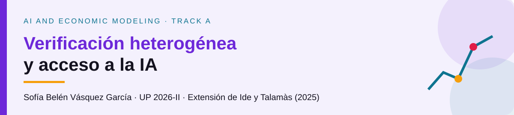

**Sofía Belén Vásquez García · Track A · AI and Economic Modeling · UP 2026-II.**

**Pregunta.** ¿Puede un gasto real de validación decreciente con conocimiento desplazar el uso directo de IA desde la base hacia tipos intermedios? Extensión propia de Ide y Talamàs (2025), **Proposición 6, p.27 de arXiv v11**.

**Modelo.** La IA no autónoma solo asesora. El costo $c(z)=\kappa(1-z)$, $\kappa\geq0$, se paga por trabajador en bien final; no cambia tiempo ni éxito. Con competencia, libre entrada, dos niveles, $0<h<1$, $a\in(0,1)$ y $\mu>h$, resulta $r=0$:

$$\max_{0\leq z\leq a}\Pi^V(z)=\frac{a-w^V(z)-c(z)}{h(1-z)}-r.$$

**Resultado y condiciones.** FOC interior diferenciable: $w^{V\prime}+c'=(a-w^V-c)/(1-z)$. Beneficio cero y $r=0$ dan $w^V=a-c$ entre usuarios; en un intervalo activo, $w^{V\prime}=\kappa$. La asignación requiere además recursos y todas las alternativas.

**Proposición propia de tres tipos.** Para tipos $(0,m,H)$, $0<m<H<1$, $m<a$, masas positivas $(\alpha,\beta,\gamma)$ de suma uno, defina $b_M=h(1-m)$, $v_L=H(1-h)$ y $v_M=H(1-b_M)$. Si $\gamma>h\alpha+b_M\beta$, $v_M>m$, $q_L<v_L$, $q_M>v_M$ y $q_H<H$ cuando $H\leq a$, donde $q_i=a-c(z_i)$, hay equilibrio único con salarios $(v_L,q_M,H)$ y solo el tipo medio usa IA. La ganancia neta es $\beta(q_M-v_M)>0$. **La distribución es discreta explícita**; el teorema del continuo queda abierto. En el ejemplo $(h,a,\kappa)=(.5,.88,.53)$, tipos $(0,.25,.76)$ y masas $(.25,.4,.35)$, el producto pasa de $.551$ a $.554$.

| Entregable | Estado al 27-oct |
|---|---|
| [Topic](slides/topic.pdf) y [propuesta](proposal/proposal.pdf) | ✅ Se conserva la entrega inicial |
| [Paper](paper/paper.pdf), `.tex` y `.bib` | ✅ 9 páginas de cuerpo, pruebas y apéndices; versión para discusión |
| [Presentación final](slides/final.pdf) | ✅ 19 slides centrales y 3 apéndices; guion de 30 min |
| [Código](code/verify.py) | ✅ SymPy, certificado racional, LP y mallas 100/200/400 |
| [Lean](lean/README.md) | ✅ Dos proposiciones: FOC y equilibrio finito completo, con existencia y unicidad |
| [Guía de derivaciones](hand/guia-derivaciones.pdf) | ✅ 10 páginas para estudiar; **comprobación y veredicto de la slide 17 recibidos; resto del manuscrito pendiente** |
| [Prompts](prompts.md) | Registro crudo y cambios; no se inventa revisión humana |

**Reproducir:** instalar `code/requirements.txt` y ejecutar `python3 code/verify.py`; compilar los cuatro `.tex` con `latexmk -pdf` en sus carpetas. Workflow de la plantilla intacto. [Lean y logs](lean/) · [Revisión independiente](paper/lean-final-review.md) · [Guion final](slides/guion-final.md) · [Búsqueda de novedad](proposal/literature-search.md).

Exposición: **28-oct, 08:20–09:05**. Slides mergeadas antes del **27-oct, 22:00 Lima**. Paper completo: **26-nov, 22:00**. El [enlace de entrega](https://github.com/alexanderquispe/AI-Econ-Modeling/issues/7#issuecomment-6028656558) ya fue publicado por la autora; no necesita otro comentario.
